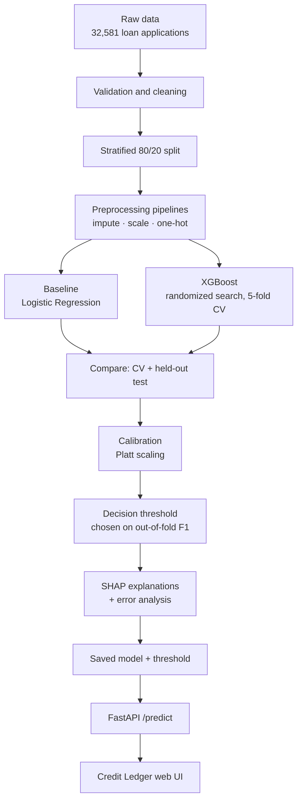

<div align="center">

# 🏦 Credit Ledger

### Explainable credit risk assessment: predict loan default probability from an applicant's profile, with calibrated probabilities and SHAP explanations.


**[🚀 Live demo](https://credit-risk-assesment-using-shap-yqij.onrender.com)**

<a href="#-highlights">Highlights</a> ·
<a href="#-model-comparison">Model comparison</a> ·
<a href="#-how-it-works">How it works</a> ·
<a href="#-run-locally">Run locally</a>

<br/>


</div>

Lenders need to decide quickly whether a loan applicant is likely to default, and to explain why. Credit Ledger takes 11 applicant and loan details, returns a **default probability and a risk verdict**, and ships with SHAP analysis showing what drives the model's decisions.

| **0.94** | **0.65 → 0.81** | **0.56 → 0.81** | **82% → 92%** |
|:---:|:---:|:---:|:---:|
| XGBoost ROC-AUC (5-fold CV) | F1 on defaulters, baseline → XGBoost | Precision on defaulters, baseline → XGBoost | Test accuracy, baseline → XGBoost |

## ✨ Highlights

- **End-to-end ML project:** data validation, preprocessing pipelines, baseline, tuned model, calibration, threshold selection, explainability, error analysis, and a deployed web app.
- **Beat a strong baseline:** tuned XGBoost improves on logistic regression by **+0.07 ROC-AUC** in cross-validation and **+16 points of F1** on the held-out test set.
- **Built for imbalanced data:** only ~22% of loans default, so training uses class weighting, stratified splits, and a PR-based tuning metric.
- **Probabilities you can trust:** Platt-scaling calibration, so a predicted risk of 30% is meant to reflect roughly a 30% chance.
- **Explainable by design:** global and per-applicant SHAP analysis show which features push risk up or down.
- **Shipped:** served through a FastAPI `/predict` endpoint with a custom web interface, deployed on Render.

## 📊 Model comparison

Same data, same split, same preprocessing framework, so the two models are directly comparable.

| Metric | Logistic Regression (baseline) | XGBoost (tuned) | Change |
|---|:---:|:---:|:---:|
| ROC-AUC (5-fold CV) | 0.871 | **0.939** | +0.068 |
| Precision, defaulters (test) | 0.56 | **0.81** | +0.25 |
| Recall, defaulters (test) | 0.79 | **0.81** | +0.02 |
| F1, defaulters (test) | 0.65 | **0.81** | +0.16 |
| Accuracy (test) | 0.82 | **0.92** | +0.10 |

<details>
<summary><b>Full cross-validation results (5-fold stratified, training data)</b></summary>

| Metric | Logistic Regression | XGBoost (default settings) |
|---|:---:|:---:|
| ROC-AUC | 0.871 | 0.939 |
| Accuracy | 0.812 | 0.909 |
| Precision | 0.545 | 0.791 |
| Recall | 0.778 | 0.786 |
| F1 | 0.641 | 0.788 |

</details>

<details>
<summary><b>Test-set classification report (6,305 applicants)</b></summary>

| Model | Class | Precision | Recall | F1 |
|---|---|:---:|:---:|:---:|
| Logistic Regression | Repaid | 0.93 | 0.83 | 0.88 |
| Logistic Regression | Default | 0.56 | 0.79 | 0.65 |
| XGBoost (tuned) | Repaid | 0.95 | 0.95 | 0.95 |
| XGBoost (tuned) | Default | 0.81 | 0.81 | 0.81 |

The tuned XGBoost model made 258 false positives and 256 false negatives on the test set, a balanced error profile that was analysed in the notebook. Test metrics are for the tuned model at the default 0.5 cut-off. The deployed model adds probability calibration and a tuned decision threshold.

</details>

## 🧠 How it works



**1. Data validation.** 32,581 rows and 12 columns. Duplicates removed (32,581 to 32,416 rows), impossible ages and employment lengths filtered out, and the interest-rate range checked. Missing employment length and interest rate values are imputed with the median inside the pipeline.

**2. Split and leakage control.** A stratified 80/20 split keeps the default rate the same in both parts (about 25,200 training and 6,305 test rows). All preprocessing lives inside scikit-learn pipelines, so it is fitted on training folds only.

**3. Preprocessing.** One `ColumnTransformer` per model. Logistic Regression gets median imputation, standard scaling and one-hot encoding. XGBoost gets median imputation and one-hot encoding, since trees don't need scaling.

**4. Imbalance handling.** About 22% of applicants default. The baseline uses `class_weight="balanced"` and XGBoost uses `scale_pos_weight` (3.63, the negative-to-positive ratio).

**5. Baseline.** A logistic regression pipeline sets the benchmark to beat.

**6. Tuning.** `RandomizedSearchCV` ran 150 candidates with 5-fold stratified cross-validation (750 fits), scored on average precision, which suits imbalanced data. Best cross-validated average precision was 0.90. The search covered tree count and depth, learning rate, row and column sampling, `min_child_weight` and `gamma`.

**7. Calibration and threshold.** The tuned model is wrapped in `CalibratedClassifierCV` (sigmoid, 5-fold). The decision threshold (about 0.59) was chosen by maximizing F1 on out-of-fold predictions, so it wasn't tuned on the test set.

**8. Explainability.** SHAP's `TreeExplainer` gives a global summary of feature impact and per-applicant waterfall plots. A false-positive and false-negative analysis shows where the model is wrong.

**9. Serving.** The calibrated model and threshold are saved with joblib and loaded by the API. The web interface posts the applicant's details to `/predict` and shows the probability, the threshold and the verdict.

## 🧰 Tech stack

| Layer | Tools |
|---|---|
| Data and ML | pandas, NumPy, scikit-learn (pipelines, ColumnTransformer, cross-validation, calibration) |
| Models | Logistic Regression (baseline), XGBoost |
| Explainability | SHAP (TreeExplainer), matplotlib, seaborn |
| Serving | FastAPI, joblib |
| Front end | HTML, CSS, JavaScript |
| Deployment | Render |

## 💻 Run locally

```bash
git clone https://github.com/<your-username>/<your-repo>.git
cd <your-repo>
pip install -r requirements.txt
uvicorn main:app --reload        # then open http://localhost:8000
```

To retrain, open `Credit_Risk.ipynb`, run all cells with `credit_risk_dataset.csv` next to it, and it will write `credit_risk_model.pkl` and `best_threshold.pkl`.

<details>
<summary><b>Project structure</b></summary>

```
.
├── Credit_Risk.ipynb          # EDA, modelling, evaluation, SHAP
├── credit_risk_model.pkl      # calibrated XGBoost pipeline
├── best_threshold.pkl         # decision threshold
├── main.py                    # FastAPI service
├── index.html                 # web interface
├── style.css
├── script.js
├── docs/                      # screenshots
└── requirements.txt
```

</details>

## 📄 License

MIT. See `LICENSE`.

---
